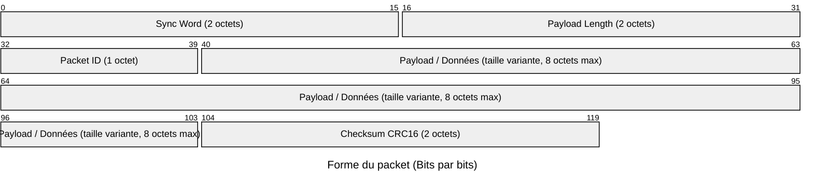
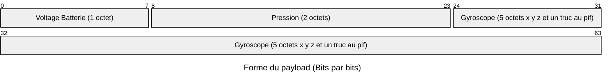

# Documentation du protocole de communication radio

## Forme du packet envoyer : 

## Type de packets : 

### 0x00 : Heartbeat
    Permet de s'assurer que la communication est encore ouverte, envoyer seulement en mode 0 càd quand la fusée est au sol désarmée et qu'elle n'envoie pas de données
    
    Le payload fait 0 octets

### 0x01 : Information
    Envoie les information de vol (voltage de la batterie, pression, orientation du gyroscope etc...) Attention : la taille des truc est faite au pif, changera plus tard

### 0x02 : GPS
    Envoie la position gps